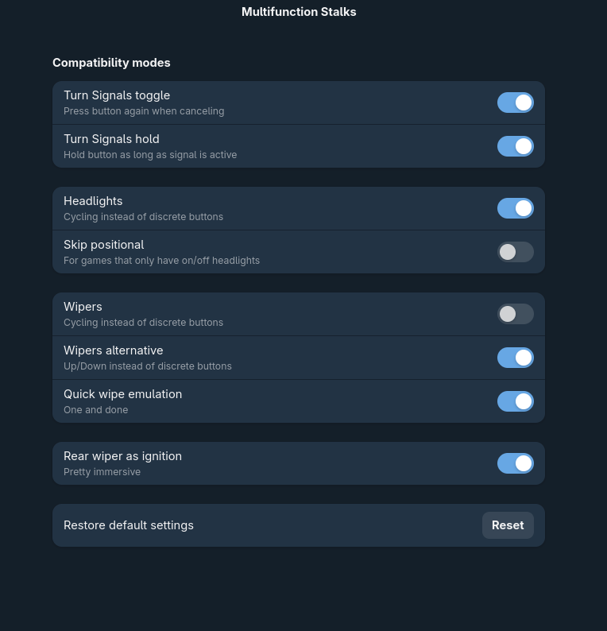

# MOZA Multifunction Stalks – ETS2 / ATS Configuration

Custom `controls.sii` configurations for using the MOZA Multifunction Stalks in **Euro Truck Simulator 2** and **American Truck Simulator**.

The configurations allow the stalks to control vehicle functions such as indicators, lighting and the retarder, with different software handling depending on the operating system.

## Configuration variants

| File / Setup | Indicator handling | Other stalk functions |
|---|---|---|
| Windows | MOZA Pit House / `controls.sii` | `controls.sii` |

## Windows – MOZA Pit House

When using the Windows configuration:

1. Install and configure MOZA Pit House.
2. Connect the Multifunction Stalks.
3. **Enable Direct Connection Mode in MOZA Pit House.**
4. Use the Windows `controls.sii` configuration.

Direct Connection Mode must be enabled for the intended control behaviour.

##  – Boxflat

On Linux, Boxflat handles the turn signals instead of the custom indicator logic in `controls.sii`.

Configure Boxflat with the following options:

Use the -specific `controls.sii` configuration.

The  configuration removes the custom indicator `memory()` expressions while retaining the normal semantic indicator bindings. This allows Boxflat to handle the indicators independently.

Lighting and retarder controls remain mapped through `controls.sii`, so Boxflat does not need to handle those functions.

## Lighting and retarder

The configuration retains the MOZA stalk mappings for:

- Lighting switch positions
- High beams
- Light horn
- Beacons
- Retarder stages

These functions are handled directly by the game through the custom `controls.sii` bindings.

## Important notes

- The MOZA Multifunction Stalks are mapped as `joy4` in the current configuration.
- Keep the Windows and  configuration variants separate.
- Back up your existing `controls.sii` before replacing it.
- Device indices may differ if your controller setup changes.

## Installation

1. Locate your ETS2 or ATS `controls.sii` file.
2. Back up the existing configuration.
3. Select the appropriate configuration for your operating system.
4. Replace the existing `controls.sii` with the selected version.
5. Configure Pit House or Boxflat as described above.
6. Rename controls__boxflat.sii to controls.sii when copying over to 

## Software

- [MOZA Pit House](https://www.mozaracing.com/)
- [Boxflat](https://github.com/Lawstorant/boxflat)
