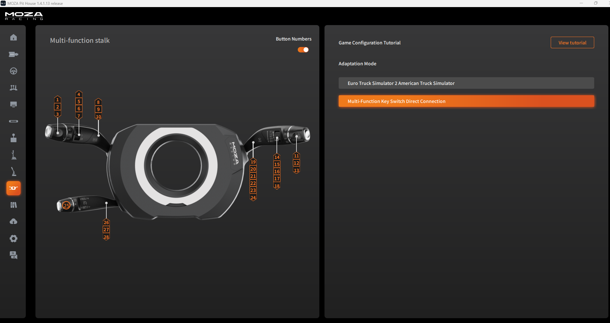
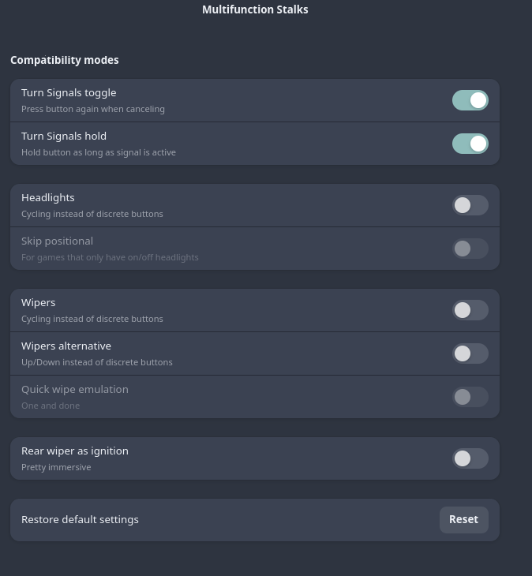

# MOZA Multifunction Stalks – ETS2 / ATS Configuration

Custom `controls.sii` configurations for using the MOZA Multifunction Stalks in **Euro Truck Simulator 2** and **American Truck Simulator**.

The configurations allow the stalks to control vehicle functions such as indicators, lighting and the retarder, with different software handling depending on the operating system.

## Configuration variants

| File / Setup | Indicator handling | Other stalk functions |
|---|---|---|
| Windows | MOZA Pit House / `controls.sii` | `controls.sii` |

## Windows – MOZA Pit House

When using the Windows configuration:

1. Install and configure MOZA Pit House.
2. Connect the Multifunction Stalks
3. **Enable Direct Connection Mode in MOZA Pit House.**



4. **Ensure the Stalks are the 4th joystick in ETS2, otherwise substitute accordingly**
5. Add the following lines to controls.sii file. 

### Rear Wiper as Ignition
```
 config_lines[348]: "mix ignitionoff `joy4.b11?0 | semantical.ignitionoff?0`"
 config_lines[349]: "mix ignitionon `joy4.b12?0 | semantical.ignitionon?0`"
 config_lines[350]: "mix ignitionstrt `joy4.b13?0 | semantical.ignitionstrt?0`"
``` 
### Retarder level (uses the wiper stalks)
```
 config_lines[369]: "mix retarder0 `joy4.b21?0 | semantical.retarder0?0`"
 config_lines[370]: "mix retarder1 `joy4.b22?0 | semantical.retarder1?0`"
 config_lines[371]: "mix retarder2 `joy4.b23?0 | semantical.retarder2?0`"
 config_lines[372]: "mix retarder3 `joy4.b24?0 | semantical.retarder3?0`"
 ```
 ### Wiper levels (uses your HI (3)-LO (2)-INT (1)-OFF wiper switch, Mist is disabled)
 ```
 config_lines[401]: "mix wipers0 `joy4.b15?0 | semantical.wipers0?0`"
 config_lines[402]: "mix wipers1 `joy4.b16?0 | semantical.wipers1?0`"
 config_lines[403]: "mix wipers2 `joy4.b17?0 | semantical.wipers2?0`"
 config_lines[404]: "mix wipers3 `joy4.b18?0 | semantical.wipers3?0`"
 ```
 ### Headlight modes
 ```
 config_lines[413]: "mix lightoff `joy4.b1?0 | semantical.lightoff?0`"
 config_lines[414]: "mix lightpark `joy4.b2?0 | semantical.lightpark?0`"
 config_lines[415]: "mix lighton `joy4.b3?0 | semantical.lighton?0`"
 ```
 ### Indicator left and right (Windows)
 ```
 config_lines[417]: "mix lblinker `keyboard.lbracket?0 | semantical.lblinker?0`"
 config_lines[418]: "mix lblinkerh `memory(joy4.b10?0 | joy4.b9?0, joy4.b10?0 & ! (joy4.b9?0)) | semantical.lblinkerh?0`"
 config_lines[419]: "mix rblinker `keyboard.rbracket?0 | semantical.rblinker?0`"
 config_lines[420]: "mix rblinkerh `memory(joy4.b8?0 | joy4.b9?0, joy4.b8?0 & ! (joy4.b9?0)) | semantical.rblinkerh?0`"
 ```
 ### Indicator left and right (Linux with Boxflat)
 ```
 config_lines[417]: "mix lblinker `keyboard.lbracket?0 | joy4.b10?0 | semantical.lblinker?0`"
 config_lines[418]: "mix lblinkerh `semantical.lblinkerh?0`"
 config_lines[419]: "mix rblinker `keyboard.rbracket?0 | joy4.b8?0 | semantical.rblinker?0`"
 config_lines[420]: "mix rblinkerh `semantical.rblinkerh?0`"
 ``` 
 ### Auxillary lights (High beams and beacons)
 ```
 config_lines[416]: "mix hblight `keyboard.k?0 | joy4.b4?0 | semantical.hblight?0`"
 config_lines[360]: "mix lighthorn `keyboard.j?0 | joy4.b6?0 | semantical.lighthorn?0`"
 config_lines[361]: "mix beacon `unbound?0 | joy4.b7?0 | semantical.beacon?0`"
 ```
 ### Cruise Control
 ```
 config_lines[406]: "mix cruiectrl `keyboard.c?0 | joy4.b25?0 | semantical.cruiectrl?0`"
 config_lines[407]: "mix cruiectrlinc `unbound?0 | joy4.b27?0 | semantical.cruiectrlinc?0`"
 config_lines[408]: "mix cruiectrldec `unbound?0 | joy4.b26?0 | semantical.cruiectrldec?0`"
 config_lines[409]: "mix cruiectrlres `unbound?0 | joy4.b28?0 | semantical.cruiectrlres?0`"
 ```
 ### Horns (Wiper stalks 19 & 20)
 ```
 config_lines[358]: "mix horn `unbound?0 | joy4.b20?0 | semantical.horn?0`"
 config_lines[359]: "mix airhorn `unbound?0 | joy4.b19?0 | semantical.airhorn?0`"
 ```
Direct Connection Mode must be enabled for the intended control behaviour.

##  – Boxflat

On Linux, Boxflat handles the turn signals instead of the custom indicator logic in `controls.sii`.

Configure Boxflat with the following options:



The configuration removes the custom indicator `memory()` expressions while retaining the normal semantic indicator bindings. This allows Boxflat to handle the indicators independently.

Lighting and retarder controls remain mapped through `controls.sii`, so neither Pithouse or Boxflat handle those functions.

## Lighting and retarder

The configuration retains the MOZA stalk mappings for:

- Lighting switch positions
- High beams
- Light horn
- Beacons
- Retarder stages

These functions are handled directly by the game through the custom `controls.sii` bindings.

## Important notes

- The MOZA Multifunction Stalks are mapped as `joy4` in the current configuration.
- Keep the Windows and  configuration variants separate.
- Back up your existing `controls.sii` before replacing it.
- Device indices may differ if your controller setup changes.

## Installation

1. Locate your ETS2 or ATS `controls.sii` file.
2. Back up the existing configuration.
3. Merge and edit the binds one by one as they config line numbering may change.

## Software

- [MOZA Pit House](https://www.mozaracing.com/)
- [Boxflat](https://github.com/Lawstorant/boxflat)
